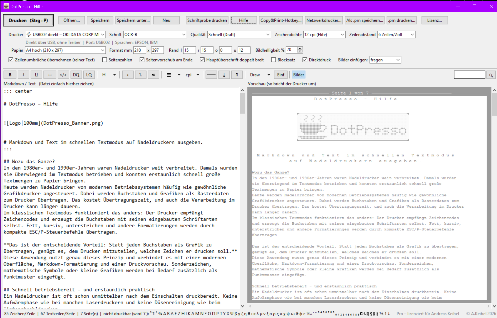
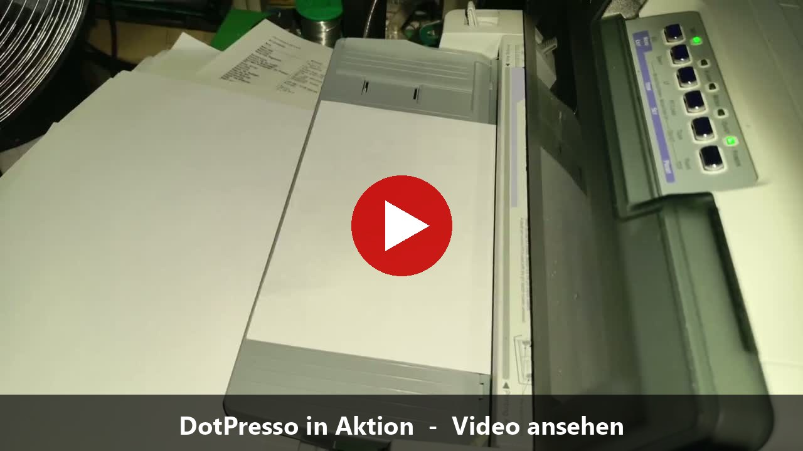
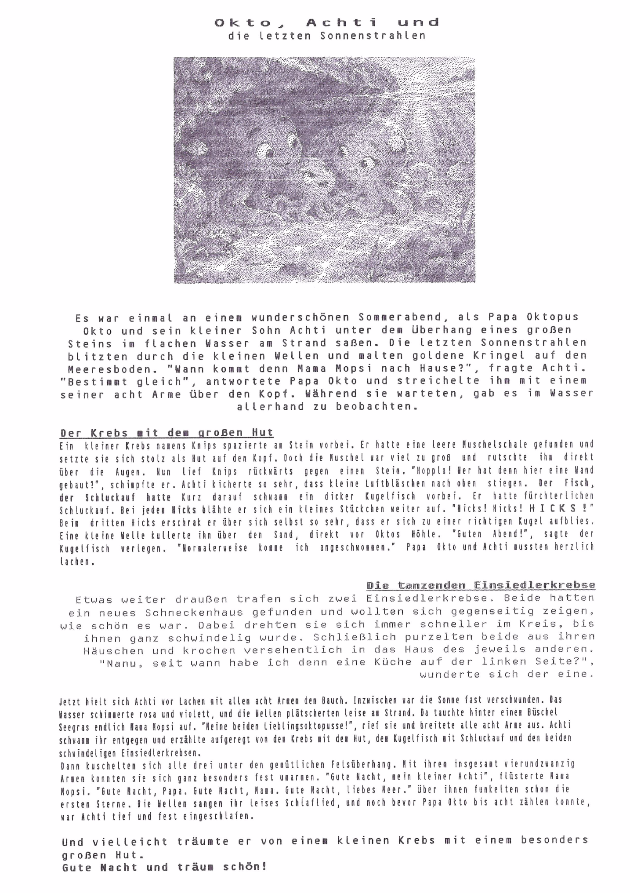
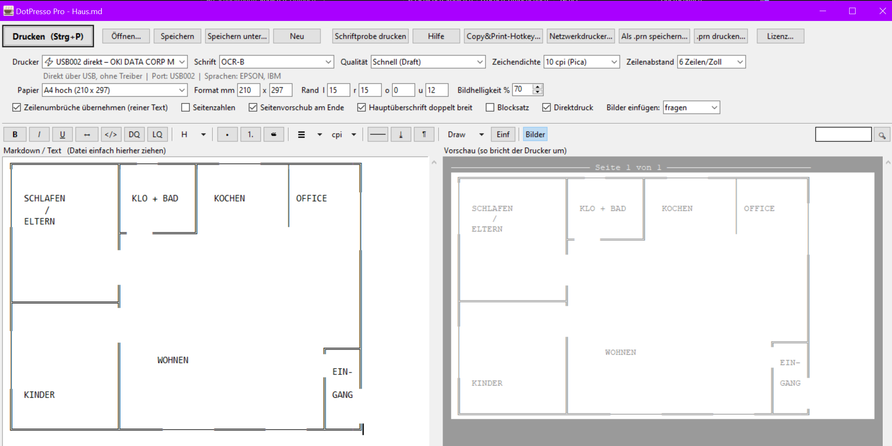

# DotPresso

[🇬🇧 English](README.md) · 🇩🇪 **Deutsch**

**Markdown und Text auf dem Nadeldrucker – im echten Textmodus, mit den eingebauten Druckerschriften.**

Schneller als jeder Windows-Grafikdruck, gestochen scharf in LQ und mit dem Klang von 1990.

[**⬇ DotPresso herunterladen**](../../releases/latest) · Windows 10/11 · Light kostenlos

---

## Was ist DotPresso?

Windows druckt auf Nadeldruckern meist als Grafik: langsam, laut und unscharf. DotPresso schickt dem Drucker stattdessen **Text und ESC/P-Befehle**. Er druckt dann mit seinen eigenen Schriften in Draft- oder Schönschrift (LQ), so wie früher unter DOS.

Formatiert wird mit **Markdown**: `**fett**`, `*kursiv*`, Überschriften, Listen und Tabellen. Rechts zeigt eine Vorschau den Umbruch genau so, wie er aufs Papier kommt.

## Funktionen

- Editor mit Vorschau, Zeilen- und Seitenumbruch wie auf dem Papier
- Fett, kursiv, unterstrichen, breit, Überschriften, Listen, Tabellen
- Zeichendichte 10–20 cpi, Draft oder Schönschrift (LQ)
- Bilder als Punktgrafik, mit einstellbarer Helligkeit
- MatrixFont: Sonderzeichen wie ★ ✓ € ½, die der Drucker selbst nicht kennt
- **Copy&Print-Hotkey Strg+Alt+N:** Text in einem beliebigen Programm markieren, die Tasten drücken – DotPresso öffnet sich damit
- **Druck über USB ohne Druckertreiber.** DotPresso erkennt geeignete Drucker selbst.
- Links im Text per Doppelklick öffnen
- **Kleine Zettel und Endlospapier:** ein *Kalibrationsblatt* zeigt, wie weit der Drucker wirklich kommt – die Ränder werden je Drucker und Papierformat gespeichert, eigene Papierformate (z. B. „Zettel (90 x 90)“) lassen sich speichern
- Programmcode 1:1 drucken: markieren, `</>` klicken
- **Spaltensatz wie in der Zeitung** (2–6 Spalten, mit dünner Trennlinie) und **Schriften je Absatz oder Wort** – Courier, OCR-B, OCR-A, Orator … was der Drucker eben hat
- Nur die Markierung drucken, z. B. eine Seite aus einem langen Text
- Zoombare Vorschau, die sich wegklappen lässt
- Oberfläche, Hilfe und Setup auf Deutsch und Englisch, umschaltbar per Knopf

## So sieht es aus

**Ausdruck auf einem OKI Microline (24 Nadeln):** Eine Gute-Nacht-Geschichte mit Bild als Punktgrafik, zentrierten, rechtsbündigen und Blocksatz-Absätzen, verschiedenen Zeichendichten sowie Draft und Schönschrift auf einer Seite – alles im Textmodus. Den Text dazu gibt es als [Okto_Achti_Mopsi.md](bilder/Okto_Achti_Mopsi.md).

**Rahmen zeichnen (Pro):** Mit „Draw“ entstehen Linien und Rahmen direkt im Text – hier ein Grundriss. Die Vorlage liegt als [Grundriss.md](bilder/Grundriss.md) bei.

## Light und Pro

| | Light (kostenlos) | Pro |
|---|:---:|:---:|
| Editor, Vorschau, alle Grundformate | ✓ | ✓ |
| Eigene Bilder, Bildhelligkeit | ✓ | ✓ |
| Copy&Print-Hotkey | ✓ | ✓ |
| Druck über USB ohne Treiber | ✓ | ✓ |
| Zentriert, rechtsbündig, Blocksatz | | ✓ |
| Zeichendichte und Draft/LQ je Absatz, Draft/LQ wortweise | | ✓ |
| Schrift je Absatz oder Wort | | ✓ |
| Spaltensatz (2–6 Spalten, Trennlinie) | | ✓ |
| Rahmen und Tabellen zeichnen, CSV → Rahmentabelle | | ✓ |
| Aufräumen: Leerzeilen entfernen, Absätze verdichten | | ✓ |
| Bilder aus der Zwischenablage und per Ziehen | | ✓ |
| Netzwerkdrucker (Printserver, Port 9100) | | ✓ |
| Druckdaten als .prn speichern und drucken | | ✓ |

Pro wird mit einem persönlichen Lizenzschlüssel freigeschaltet – offline, ohne Konto und ohne Internetverbindung. Den Schlüssel trägt man einmal im Programm ein.

**<u> Pro für nur 29€ kaufen</u>:** 
1. Bestellung an a.keibel@systragon.de 
2. 29€ Zahlung per Paypal an a.keibel@systragon.de  
3. Lizenzschlüssel auf Klarnamen wird ihnen schnellstmöglich zugestellt. 
4. Mit Eingabe des Schlüssels ist DotPresso Pro sofort freigeschaltet

## Geeignete Drucker

Nadeldrucker mit **Epson-ESC/P-Befehlssatz und 24 Nadeln**, zum Beispiel:

- Epson LQ-Serie
- OKI ML-Serie in Epson-Emulation
- Star LC-24
- Panasonic KX-P2xxx
- NEC Pinwriter

Bei 9-Nadel-Druckern (Epson FX, Star LC-10 …) geht Text meist, Bilder aber nicht. Steht der Drucker auf IBM-Emulation, am Bedienfeld oder per DIP-Schalter auf Epson umstellen.

Anschluss per **USB**, auch über ein USB-auf-Parallel-Kabel, oder mit Pro über einen **Netzwerk-Printserver**. Ein Druckertreiber ist nicht nötig.

> Dein Drucker läuft mit DotPresso – oder gerade nicht? Erzähl es in den [Issues](../../issues). So entsteht eine Liste geprüfter Drucker.

## Installation

1. [`DotPresso-…-Setup.exe`](../../releases/latest) herunterladen und starten.
2. Drucker per USB anschließen und einschalten.
3. DotPresso starten. Der Drucker erscheint in der Auswahl als `⚡ USB00x direkt – Hersteller Modell`.
4. Zuerst **Schriftprobe drucken**: Sie zeigt, welche Schriften der Drucker wirklich hat.
5. Dann die mitgelieferte **Testseite** öffnen und drucken.

Windows meldet beim ersten Start vielleicht „Der Computer wurde durch Windows geschützt“. Das liegt daran, dass das Programm (noch) nicht digital signiert ist. Mit „Weitere Informationen“ → „Trotzdem ausführen“ geht es weiter.

## Fragen und Fehler

Fehler, Wünsche und Druckerberichte bitte in die [Issues](../../issues).

---

© 2026 Andreas Keibel. DotPresso ist keine Open-Source-Software; dieses Repository dient der Veröffentlichung und dem Austausch. Der MatrixFont enthält Glyphen aus Terminus Font und GNU Unifont (SIL Open Font License 1.1).
