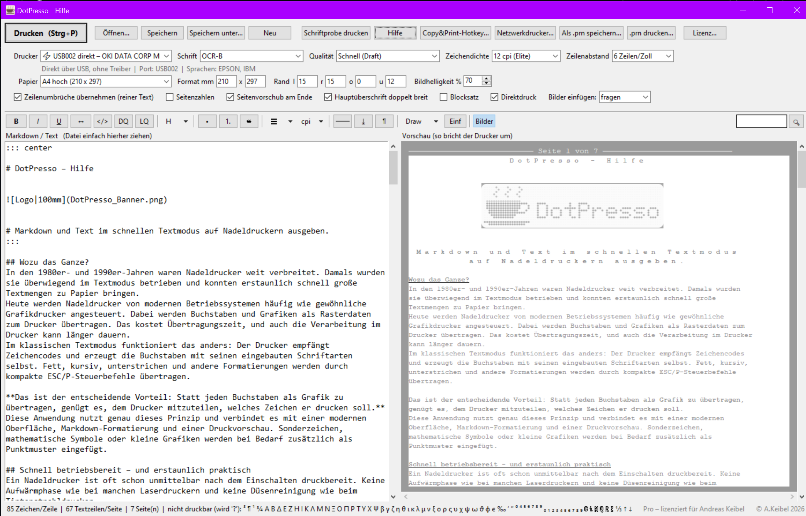
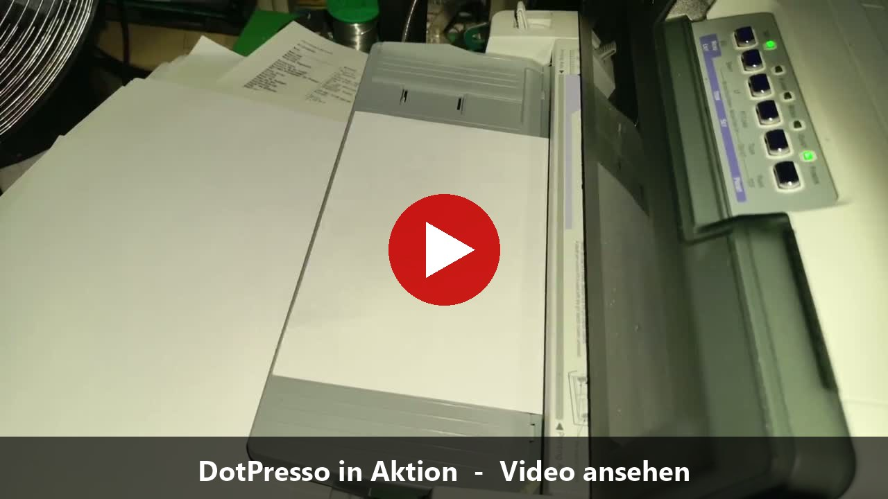
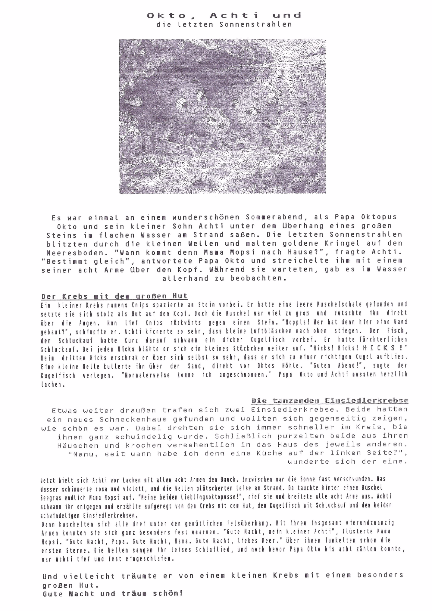
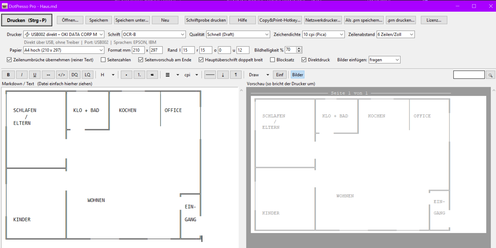

# DotPresso

🇬🇧 **English** · [🇩🇪 Deutsch](README.de.md)

**Markdown and text on your dot matrix printer – in true text mode, with the printer's built-in fonts.**

Faster than any Windows graphics printout, crisp in Letter Quality, and with the sound of 1990.

[**⬇ Download DotPresso**](../../releases/latest) · Windows 10/11 · Light is free

---

## What is DotPresso?

Windows usually prints to dot matrix printers as graphics: slow, loud and fuzzy. DotPresso sends the printer **text and ESC/P commands** instead. The printer then uses its own fonts in Draft or Letter Quality (LQ), just like back in the DOS days.

Formatting is done with **Markdown**: `**bold**`, `*italic*`, headings, lists and tables. On the right, a preview shows the line breaks exactly as they will come out on paper.

## Features

- Editor with preview, line and page breaks just like on paper
- Bold, italic, underline, double width, headings, lists, tables
- Pitch 10–20 cpi, Draft or Letter Quality (LQ)
- Images as dot graphics, with adjustable brightness
- MatrixFont: special characters such as ★ ✓ € ½ that the printer itself doesn't know
- **Copy&Print hotkey Ctrl+Alt+N:** select text in any program, press the keys – DotPresso opens with it
- **Printing via USB without a printer driver.** DotPresso detects suitable printers by itself.
- Open links in the text with a double-click
- **Small notes and continuous paper:** a *calibration sheet* finds out what your printer can really reach – margins are stored per printer and paper size, and you can save your own paper sizes (e.g. "Note (90 x 90)")
- Print program code 1:1: select it, click `</>`
- **Columns like a newspaper** (2–6, with a thin rule) and **typefaces per paragraph or word** – Courier, OCR-B, OCR-A, Orator … whatever your printer has
- Print just a selection, e.g. one page of a long text
- Zoomable preview that you can fold away
- Interface, help and setup in English and German, switchable with one button

## What it looks like

**Printout on an OKI Microline (24 pins):** a bedtime story with an image as dot graphics, centered, right-aligned and justified paragraphs, different pitches, and Draft and Letter Quality on one page – all in text mode. The source text (in German) is available as [Okto_Achti_Mopsi.md](bilder/Okto_Achti_Mopsi.md).

**Drawing frames (Pro):** with "Draw", lines and frames are created right in the text – here a floor plan. The source is included as [Grundriss.md](bilder/Grundriss.md).

## Light and Pro

| | Light (free) | Pro |
|---|:---:|:---:|
| Editor, preview, all basic formats | ✓ | ✓ |
| Your own images, image brightness | ✓ | ✓ |
| Copy&Print hotkey | ✓ | ✓ |
| Printing via USB without a driver | ✓ | ✓ |
| Centered, right-aligned, justified | | ✓ |
| Pitch and Draft/LQ per paragraph, Draft/LQ per word | | ✓ |
| Typeface per paragraph or word | | ✓ |
| Columns (2–6, with rule) | | ✓ |
| Drawing frames and tables, CSV → framed table | | ✓ |
| Tidy up: remove blank lines, compact paragraphs | | ✓ |
| Images from the clipboard and by drag & drop | | ✓ |
| Network printers (print server, port 9100) | | ✓ |
| Saving and printing print data as .prn | | ✓ |

Pro is unlocked with a personal license key – offline, without an account and without an internet connection. You enter the key once in the program.

**Buy Pro for just €29:**
1. Send your order to a.keibel@systragon.de
2. Pay €29 via PayPal to a.keibel@systragon.de
3. You will receive your license key, issued to your real name, as soon as possible.
4. Enter the key and DotPresso Pro is unlocked immediately.

## Suitable printers

Dot matrix printers with the **Epson ESC/P command set and 24 pins**, for example:

- Epson LQ series
- OKI ML series in Epson emulation
- Star LC-24
- Panasonic KX-P2xxx
- NEC Pinwriter

With 9-pin printers (Epson FX, Star LC-10 …) text usually works, but images don't. If the printer is set to IBM emulation, switch it to Epson on the control panel or with the DIP switches.

Connection via **USB**, also through a USB-to-parallel cable, or with Pro via a **network print server**. No printer driver is needed.

> Does your printer work with DotPresso – or not quite? Tell us in the [Issues](../../issues). That way a list of tested printers grows.

## Installation

1. Download [`DotPresso-…-Setup.exe`](../../releases/latest) and run it. The setup asks for the language (English or German).
2. Connect the printer via USB and switch it on.
3. Start DotPresso. The printer appears in the list as `⚡ USB00x direkt – Manufacturer Model`.
4. First click **Print font sample**: it shows which fonts the printer really has.
5. Then open the included **Test page** and print it.

On the first start, Windows may say "Windows protected your PC". That is because the program is not (yet) digitally signed. Click "More info" → "Run anyway" to continue.

## Questions and bugs

Please report bugs, wishes and printer reports in the [Issues](../../issues).

---

© 2026 Andreas Keibel. DotPresso is not open-source software; this repository is for publication and exchange. The MatrixFont contains glyphs from Terminus Font and GNU Unifont (SIL Open Font License 1.1).
