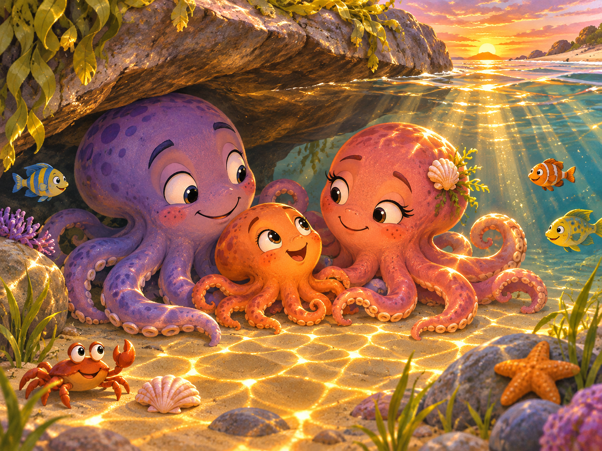

# Okto, Achti und die letzten Sonnenstrahlen

Es war einmal an einem wunderschönen Sommerabend, als Papa Oktopus Okto und sein kleiner Sohn Achti unter dem Überhang eines großen Steins im flachen Wasser am Strand saßen. Die letzten Sonnenstrahlen blitzten durch die kleinen Wellen und malten goldene Kringel auf den Meeresboden. „Wann kommt denn Mama Mopsi nach Hause?“, fragte Achti. „Bestimmt gleich“, antwortete Papa Okto und streichelte ihm mit einem seiner acht Arme über den Kopf. Während sie warteten, gab es im Wasser allerhand zu beobachten.

<u>**Der Krebs mit dem großen Hut**</u>

Ein kleiner Krebs namens Knips spazierte am Stein vorbei. Er hatte eine leere Muschelschale gefunden und setzte sie sich stolz als Hut auf den Kopf. Doch die Muschel war viel zu groß und rutschte ihm direkt über die Augen. Nun lief Knips rückwärts gegen einen Stein. „Hoppla! Wer hat denn hier eine Wand gebaut?“, schimpfte er. Achti kicherte so sehr, dass kleine Luftbläschen nach oben stiegen. **Der Fisch, der Schluckauf hatte** Kurz darauf schwamm ein dicker Kugelfisch vorbei. Er hatte fürchterlichen Schluckauf. Bei jedem **Hicks** blähte er sich ein kleines Stückchen weiter auf. „Hicks! Hicks! <big>HICKS!</big>“ Beim dritten Hicks erschrak er über sich selbst so sehr, dass er sich zu einer richtigen Kugel aufblies. Eine kleine Welle kullerte ihn über den Sand, direkt vor Oktos Höhle. „Guten Abend!“, sagte der Kugelfisch verlegen. „Normalerweise komme ich angeschwommen.“ Papa Okto und Achti mussten herzlich lachen.

<dq><u>**Die tanzenden Einsiedlerkrebse**</u>
Etwas weiter draußen trafen sich zwei Einsiedlerkrebse. Beide hatten ein neues Schneckenhaus gefunden und wollten sich gegenseitig zeigen, wie schön es war. Dabei drehten sie sich immer schneller im Kreis, bis ihnen ganz schwindelig wurde. Schließlich purzelten beide aus ihren Häuschen und krochen versehentlich in das Haus des jeweils anderen. „Nanu, seit wann habe ich denn eine Küche auf der linken Seite?“, wunderte sich der eine. </dq>

Jetzt hielt sich Achti vor Lachen mit allen acht Armen den Bauch. Inzwischen war die Sonne fast verschwunden. Das Wasser schimmerte rosa und violett, und die Wellen plätscherten leise am Strand. Da tauchte hinter einem Büschel Seegras endlich <lq>Mama Mopsi</lq> auf. „Meine beiden Lieblingsoktopusse!“, rief sie und breitete alle acht Arme aus. Achti schwamm ihr entgegen und erzählte aufgeregt von dem Krebs mit dem Hut, dem Kugelfisch mit Schluckauf und den beiden schwindeligen Einsiedlerkrebsen.

> Dann kuschelten sich alle drei unter den gemütlichen Felsüberhang. Mit ihren insgesamt vierundzwanzig Armen konnten sie sich ganz besonders fest umarmen. „Gute Nacht, mein kleiner Achti“, flüsterte Mama Mopsi. „Gute Nacht, Papa. Gute Nacht, Mama. Gute Nacht, liebes Meer.“ Über ihnen funkelten schon die ersten Sterne. Die Wellen sangen ihr leises Schlaflied, und noch bevor Papa Okto bis acht zählen konnte, war Achti tief und fest eingeschlafen.

Und vielleicht träumte er von einem kleinen Krebs mit einem besonders großen Hut.
**Gute Nacht und träum schön!**
